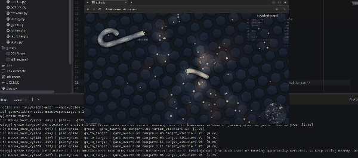

**gm-autoplayer**, an AI agent that plays browser games like slither.io by looking at the screen and moving the mouse, one decision at a time.

No hidden bot inside the page, no game APIs. The agent only sees screenshots, just like a human player, and every move comes from a model.

**Why a game?** Games give instant feedback. When the agent makes a bad decision, the snake dies, and you see it straight away. That makes it a great way to learn how agents actually behave, not how they behave in a demo.

## The problem: smart is slow, fast is dumb

My first version was the obvious one. Give each screenshot to an LLM (GPT-4.1 mini) and let it call the browser's mouse and keyboard tools through the Playwright MCP server.

It worked, but it took about 2–5 seconds per move. In a real-time game like slither.io, that's far too slow. By the time the model decided to turn away from another snake, the snake was already dead.

So I tried a second "brain": **Jev** from TypeSafe. Instead of asking it "what should I do?", I ask it small, typed questions about each screenshot, like "Is a snake about to hit me?" or "Where is the nearest food?". Simple rules then turn those answers into moves. Jev took about 0.5–1.5 seconds per move, much faster, but it wasn't as good at understanding the game as a whole.

## The solution: a strategist and reflexes

The third brain combines both, and it's the one I'm most happy with.

- **The LLM is the strategist.** Every couple of seconds, in the background, it looks at the screen and sets a plan, like "go for the purple orb trail left of centre."
- **Jev handles the reflexes.** It makes every move quickly, follows the plan, and dodges danger on its own without waiting for the LLM.

This is close to how people play. You don't think deeply about every single move. You set a goal, and your reflexes handle the rest. Survival rules always come first, so if danger appears, Jev escapes even if the plan says otherwise.

## What I learned

**Latency is a design constraint, not a detail.** The smartest model isn't useful if it answers too late. Choosing the right model for each job mattered more than choosing the "best" model.

**Structure makes agents explainable.** With Jev, every move shows which rule fired and what the answers were, for example `feast | danger=0.25 dead_snake_food_visible=0.90`. When something goes wrong, I can see _why_ it moved, instead of guessing what an LLM was thinking.

**Know how your tools fail.** Jev's "where is it?" questions always return a box, even when the thing isn't on screen. If I trusted that blindly, the snake would chase food that didn't exist. So every location question is paired with a yes/no question first ("Is there food visible?"). This is exactly the kind of thing I mean when I say I want to understand when systems break, not just ship them.

**Keep costs flat.** Each move is a paid API call, so the agent only remembers its last few moves as text. That way the cost per move stays the same no matter how long the game runs.

## Built to be extended

I designed it so new games and new brains don't need changes to the core code:

- **Each game is one TOML file** with its URL, prompts, questions and rules. Slither.io and 2048 are included.
- **Each brain implements one small interface.** Adding a new one is a single file plus one line in a registry.

The game loop itself is simple: take a screenshot, let the brain decide, run the moves, repeat.

## What's next

Tuning the rules, trying other games, and testing local models in my homelab.

The code is open source on GitHub: [sugeesh/gm-autoplayer](https://github.com/sugeesh/gm-autoplayer). If you're learning agent engineering too, I'd love to hear what you're building.
